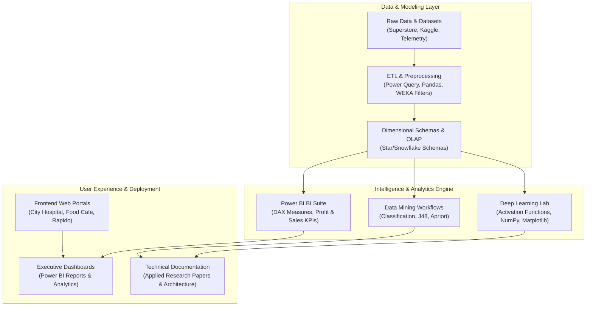

<div align="center">


[](https://github.com/akashvenkey)
[-4F46E5?style=for-the-badge&logo=academia&logoColor=white)](https://github.com/akashvenkey)
[](https://www.alliance.edu.in/)
[](https://github.com/akashvenkey)
[](#)

</div>

---

## 📌 Executive Summary & Overview

Welcome to the central developer portfolio and repository hub of **Akash V** (`akashvenkey`). I am a software engineer and Bachelor of Computer Applications (Honors) scholar at Alliance University, Bangalore, focusing on the intersection of **Artificial Intelligence**, **Business Intelligence & Data Analytics**, and **Full-Stack Web Engineering**.

This portfolio repository acts as the central index and architectural map for my open-source projects, research reports, interactive dashboards, and full-stack software systems. My work emphasizes mathematically grounded algorithms, performant data pipelines, intuitive user interfaces, and enterprise-grade documentation designed to meet high recruiter standards.

---

## 📑 Interactive Table of Contents

- [📌 Executive Summary & Overview](#-executive-summary--overview)
- [✨ Key Features & Technical Highlights](#-key-features--technical-highlights)
- [🏗 System Architecture & Ecosystem Pipeline](#-system-architecture--ecosystem-pipeline)
- [🛠 Tech Stack Breakdown](#-tech-stack-breakdown)
- [🚀 Reproducible Quickstart & Setup](#-reproducible-quickstart--setup)
- [📂 Project Directory Layout](#-project-directory-layout)
- [👨‍💻 Author & Contributions](#-author--contributions)

---

## ✨ Key Features & Technical Highlights

- **🧠 Deep Learning & Neural Architectures:** Mathematical formulation and empirical benchmarking of activation functions (Sigmoid, ReLU, Tanh), vanishing gradient analysis, and published research reviews in AI ethics and generative media.
- **📊 Enterprise Business Intelligence:** End-to-end data pipelines built in Power BI, utilizing advanced DAX measures, star-schema data modeling, and retail performance diagnostics on the Superstore dataset.
- **🌱 Sustainable Computing & Precision Agriculture:** Explorations into IoT telemetry, edge AI processing, and machine learning models for resource optimization and eco-friendly farming systems.
- **🌐 Full-Stack Application Suites:** Modular web applications featuring hospital management directories, streaming platform interfaces, and urban transit ride-booking systems with responsive layouts.
- **⛏ Data Warehousing & Data Mining (DWM):** In-depth multidimensional OLAP cubes, ETL pipeline design, star/snowflake schema structuring, and association rule mining algorithms in WEKA.

---

## 🏗 System Architecture & Ecosystem Pipeline

The following flowchart illustrates the engineering pillars and technical relationships across my repository ecosystem:



---

## 🛠 Tech Stack Breakdown

| Category | Technologies & Tools |
| :--- | :--- |
| **Core Languages** | Python 3.10+, JavaScript (ES6+), HTML5, CSS3, DAX, SQL, Java |
| **Data & BI Tools** | Microsoft Power BI Desktop, Power Query, WEKA Data Mining Workbench, Excel |
| **Libraries & Frameworks** | NumPy, Matplotlib, Jupyter Notebooks, Flexbox/Grid Layouts |
| **Database & Modeling** | Relational Database Design, Star Schema, Snowflake Schema, OLAP Cubes |
| **VCS & Environments** | Git, GitHub, VS Code, Anaconda, Windows PowerShell |

---

## 🚀 Reproducible Quickstart & Setup

### Prerequisites
- Modern Web Browser (Chrome, Firefox, or Edge)
- Python 3.9+ with `pip`
- Git installed on your local environment

### Clone & Explore Repositories
```bash
# Clone this central profile repository
git clone https://github.com/akashvenkey/Akash-venktesh.git

# Navigate into the project folder
cd Akash-venktesh

# Explore related repositories from the portfolio
git clone https://github.com/akashvenkey/Deep-Learning-.git
git clone https://github.com/akashvenkey/Business-Analytics.3.git
git clone https://github.com/akashvenkey/projects.git
```

---

## 📂 Project Directory Layout

```plaintext
Akash-venktesh/
├── README.md               # Central engineering showcase & profile overview
└── assets/                 # Profile media, badges, and architectural diagrams
```

### Complete Repository Ecosystem Index

| Repository | Domain | Core Tech Stack | Focus Area |
| :--- | :--- | :--- | :--- |
| [`Deep-Learning-`](https://github.com/akashvenkey/Deep-Learning-) | AI & Neural Networks | Python, NumPy, Matplotlib | Activation Functions & AI Ethics |
| [`Business-Analytics.3`](https://github.com/akashvenkey/Business-Analytics.3) | Business Intelligence | Power BI, DAX, Power Query | Superstore Sales & Profit Dashboards |
| [`Artificial-intelligence`](https://github.com/akashvenkey/Artificial-intelligence) | Sustainable Computing | AI Research, Precision AgTech | Sustainable Agriculture & Smart Farming |
| [`project-fsd`](https://github.com/akashvenkey/project-fsd) | Full-Stack Web Development | HTML5, CSS3, JavaScript | Hospital Systems & Netflix Clone |
| [`projects`](https://github.com/akashvenkey/projects) | Web Applications | HTML5, CSS3, UI/UX Design | Food Cafe, Hospital & Rapido Portals |
| [`project-`](https://github.com/akashvenkey/project-) | Data Warehousing & Mining | DWM, OLAP, Star Schema | Enterprise ETL & OLAP Modeling |
| [`WEKA`](https://github.com/akashvenkey/WEKA) | Machine Learning Lab | WEKA, Java, ARFF | Supervised Classification & Clustering |
| [`Business-Analytics`](https://github.com/akashvenkey/Business-Analytics) | Data Strategy | Business Modeling, KPI Analysis | Statistical Decision Intelligence |
| [`Business-Analytics.1`](https://github.com/akashvenkey/Business-Analytics.1) | Financial Analytics | EDA, Customer Segmentation | RFM Modeling & Price Sensitivity |
| [`Akash-v`](https://github.com/akashvenkey/Akash-v) | Developer Showcase | Multi-stack Engineering | Academic & Project Portfolio Hub |

---

## 👨‍💻 Author & Contributions

**Akash V**  
- **GitHub:** [@akashvenkey](https://github.com/akashvenkey)  
- **Program:** Bachelor of Computer Applications (Honors), Alliance University  
- **Interests:** Deep Learning, Business Analytics, Full-Stack Development & Applied AI

Contributions, issue submissions, and constructive feedback are warmly encouraged. Feel free to star the repositories if you find the architectures helpful!

---

<div align="center">


</div>