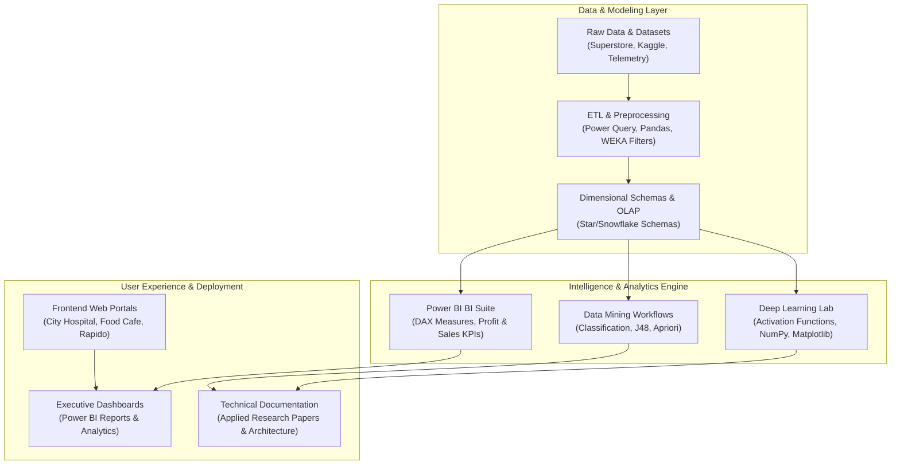



### 🔗 **GitHub Profile:** [https://github.com/akashvenkey](https://github.com/akashvenkey)

[-4F46E5?style=for-the-badge&logo=academia&logoColor=white)](https://github.com/akashvenkey)

---

## 👋 Hi there! I'm Akash V

I am an aspiring **Data Analyst & Software Engineer** pursuing a **Bachelor of Computer Applications (Honors)** at **Alliance University**, Bengaluru. I specialize in designing end-to-end data pipelines, building interactive business intelligence dashboards in **Microsoft Power BI**, benchmarking neural network architectures in **Python**, and developing modular **Full-Stack Web Applications**.

Driven by analytical rigor and clean system architecture, my engineering philosophy bridges complex data transformations with intuitive user experiences.

---

## 🔭 Current Focus & Learning

- 🧠 **Deep Learning:** Investigating gradient saturation in non-linear activation functions and researching ethical AI frameworks.
- 📊 **Business Intelligence:** Engineering advanced DAX measures, star-schema data models, and financial elasticity simulations.
- 🌐 **Full-Stack Engineering:** Building accessible, responsive web interfaces and clinical scheduling portals with semantic HTML5, CSS3, and JavaScript.
- ☁️ **Cloud & Scalability:** Exploring cloud-native ETL workflows and data warehousing paradigms.

---

## 🛠 Tech Stack & Tools

| Domain | Technologies, Frameworks & Platforms |
| :--- | :--- |
| **Languages** |       |
| **Data & BI** |      |
| **Database & Modeling** |    |
| **Tools & Platforms** |     |

---

## ⭐ Featured Projects

### 1. 📊 [Superstore BI Analytics](https://github.com/akashvenkey/Business-Analytics.3)
> **Enterprise Business Intelligence & Retail Diagnostics in Power BI**
- End-to-end interactive reporting suite diagnosing retail margins across 9,994 transactional records from the Superstore dataset.
- Engineered dynamic DAX KPI engines evaluating profit margin leaks, customer segment contributions, and discount elasticity.
- **🔗 Source Link:** [github.com/akashvenkey/Business-Analytics.3](https://github.com/akashvenkey/Business-Analytics.3)

### 2. 🧠 [Deep Learning Lab](https://github.com/akashvenkey/Deep-Learning-)
> **Mathematical Formulations & Empirical Activation Curve Benchmarking**
- Vectorized Python and NumPy implementations of Sigmoid, ReLU, and Tanh activation functions with continuous response curve plotting in Matplotlib.
- Includes applied research publications examining AI in entertainment and ethical considerations in deep learning models.
- **🔗 Source Link:** [github.com/akashvenkey/Deep-Learning-](https://github.com/akashvenkey/Deep-Learning-)

### 3. 🌐 [Web Application Suites](https://github.com/akashvenkey/projects)
> **Production-Ready Web Interfaces with Live GitHub Pages Deployment**
- Clean, responsive web portals built with semantic HTML5 and modern CSS3: Food Cafe dining showcase, City Hospital clinical directory, and Rapido mobility booking UI.
- **🔗 Source Link:** [github.com/akashvenkey/projects](https://github.com/akashvenkey/projects) | **🚀 Live Demo:** [akashvenkey.github.io/projects](https://akashvenkey.github.io/projects/)

### 4. ⛏ [Enterprise DWM Engine](https://github.com/akashvenkey/project-)
> **Data Warehousing, Multidimensional OLAP Cubes & Star Schemas**
- Comprehensive dimensional schema design, ETL pipeline automation, multidimensional OLAP cubes (roll-up, drill-down, slice, dice), and Apriori association rule discovery.
- **🔗 Source Link:** [github.com/akashvenkey/project-](https://github.com/akashvenkey/project-)

---

## 🚀 Complete Repository Showcase (Header Banners & Source Links)

### 1. Deep Learning Lab

🔗 **Source Link:** [`https://github.com/akashvenkey/Deep-Learning-`](https://github.com/akashvenkey/Deep-Learning-)

---

### 2. Superstore BI Analytics

🔗 **Source Link:** [`https://github.com/akashvenkey/Business-Analytics.3`](https://github.com/akashvenkey/Business-Analytics.3)

---

### 3. Sustainable Agri AI

🔗 **Source Link:** [`https://github.com/akashvenkey/Artificial-intelligence`](https://github.com/akashvenkey/Artificial-intelligence)

---

### 4. Full-Stack Web Suites

🔗 **Source Link:** [`https://github.com/akashvenkey/project-fsd`](https://github.com/akashvenkey/project-fsd)

---

### 5. Web Application Suites

🔗 **Source Link:** [`https://github.com/akashvenkey/projects`](https://github.com/akashvenkey/projects) | 🚀 **Live Demo:** [akashvenkey.github.io/projects](https://akashvenkey.github.io/projects/)

---

### 6. Enterprise DWM Engine

🔗 **Source Link:** [`https://github.com/akashvenkey/project-`](https://github.com/akashvenkey/project-)

---

### 7. WEKA Data Mining Lab

🔗 **Source Link:** [`https://github.com/akashvenkey/WEKA`](https://github.com/akashvenkey/WEKA)

---

### 8. Business Analytics Core

🔗 **Source Link:** [`https://github.com/akashvenkey/Business-Analytics`](https://github.com/akashvenkey/Business-Analytics)

---

### 9. Financial & Market Analytics

🔗 **Source Link:** [`https://github.com/akashvenkey/Business-Analytics.1`](https://github.com/akashvenkey/Business-Analytics.1)

---

### 10. Akash V Engineering Hub

🔗 **Source Link:** [`https://github.com/akashvenkey/Akash-v`](https://github.com/akashvenkey/Akash-v)

---

## 🏗 System Architecture & Ecosystem Pipeline

---

## 📫 How to Reach Me & Connect

- **💼 Email:** [akashbca24@ced.alliance.edu.in](mailto:akashbca24@ced.alliance.edu.in)
- **🐙 GitHub:** [@akashvenkey](https://github.com/akashvenkey)
- **📍 Location:** Bengaluru, Karnataka, India
- **🎓 Institution:** Department of Computer Application, Alliance University
- **💼 Recruitment Status:** Actively Available for Internship & Full-Time Software Engineering / Data Analyst roles

---

