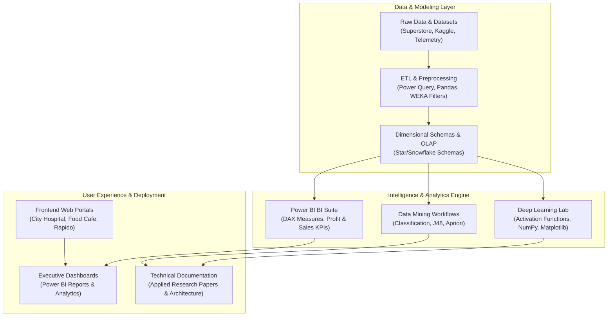

<div align="center">

<a href="https://github.com/akashvenkey">
  
</a>

### 🔗 **GitHub Profile:** [https://github.com/akashvenkey](https://github.com/akashvenkey)

[](https://github.com/akashvenkey)
[-4F46E5?style=for-the-badge&logo=academia&logoColor=white)](https://github.com/akashvenkey)
[](https://www.alliance.edu.in/)
[](https://github.com/akashvenkey)
[](#)

</div>

---

## 📌 Executive Summary & Overview

Welcome to the central developer portfolio and repository hub of **Akash V** ([@akashvenkey](https://github.com/akashvenkey)). I am a software engineer and Bachelor of Computer Applications (Honors) scholar at **Alliance University**, Bangalore, specializing in **Deep Learning & Artificial Intelligence**, **Enterprise Business Intelligence (Power BI)**, **Full-Stack Web Development**, and **Data Warehousing & Data Mining**.

This portfolio repository indexes my open-source projects, applied research reports, interactive dashboards, and full-stack software systems. Below you will find every project accompanied by its **official header banner**, **direct source code link**, **system architecture**, and **technical summary**.

---

## 📑 Interactive Table of Contents

- [📌 Executive Summary & Overview](#-executive-summary--overview)
- [🚀 Featured Projects Showcase (Banners & Source Links)](#-featured-projects-showcase-banners--source-links)
  - [1. Deep Learning Lab](#1--deep-learning-lab)
  - [2. Superstore BI Analytics](#2--superstore-bi-analytics)
  - [3. Sustainable Agri AI](#3--sustainable-agri-ai)
  - [4. Full-Stack Web Suites](#4--full-stack-web-suites)
  - [5. Web Application Suites](#5--web-application-suites)
  - [6. Enterprise DWM Engine](#6--enterprise-dwm-engine)
  - [7. WEKA Data Mining Lab](#7--weka-data-mining-lab)
  - [8. Business Analytics Core](#8--business-analytics-core)
  - [9. Financial & Market Analytics](#9--financial--market-analytics)
  - [10. Akash V Engineering Hub](#10--akash-v-engineering-hub)
- [🏗 System Architecture & Ecosystem Pipeline](#-system-architecture--ecosystem-pipeline)
- [🛠 Tech Stack Breakdown](#-tech-stack-breakdown)
- [🚀 Reproducible Quickstart & Setup](#-reproducible-quickstart--setup)
- [👨‍💻 Author & Contributions](#-author--contributions)

---

## 🚀 Featured Projects Showcase (Banners & Source Links)

### 1. 🧠 Deep Learning Lab
<div align="center">

<a href="https://github.com/akashvenkey/Deep-Learning-">
  
</a>

#### 🔗 **Source Link:** [`https://github.com/akashvenkey/Deep-Learning-`](https://github.com/akashvenkey/Deep-Learning-)

[](https://github.com/akashvenkey/Deep-Learning-)
[](https://github.com/akashvenkey/Deep-Learning-)

</div>

- **Overview:** Mathematical formulations and continuous response curve benchmarking for Sigmoid, ReLU, and Tanh activation functions, vanishing gradient diagnostics, and AI ethics research papers.
- **Key Files:** `Project_5 (1).ipynb`, `AI_in_Entertainment.pdf`, `Project4_Ethical_Considerations_in_Deep_Learning+(4).pdf`.
- **Repository URL:** [https://github.com/akashvenkey/Deep-Learning-](https://github.com/akashvenkey/Deep-Learning-)

---

### 2. 📊 Superstore BI Analytics
<div align="center">

<a href="https://github.com/akashvenkey/Business-Analytics.3">
  
</a>

#### 🔗 **Source Link:** [`https://github.com/akashvenkey/Business-Analytics.3`](https://github.com/akashvenkey/Business-Analytics.3)

[](https://github.com/akashvenkey/Business-Analytics.3)
[](https://github.com/akashvenkey/Business-Analytics.3)

</div>

- **Overview:** Multi-page executive dashboard diagnosing retail profit margin leaks, customer segment performance, and discount sensitivity across 9,994 transactional records from the Superstore dataset.
- **Key Files:** `Experiment 2 BI.pbix`, `BA Assignment 1.pbix`, `Superstore_Power_BI_Report.docx`, `POWER_BI_ASSIGNMENT.pdf`.
- **Repository URL:** [https://github.com/akashvenkey/Business-Analytics.3](https://github.com/akashvenkey/Business-Analytics.3)

---

### 3. 🌱 Sustainable Agri AI
<div align="center">

<a href="https://github.com/akashvenkey/Artificial-intelligence">
  
</a>

#### 🔗 **Source Link:** [`https://github.com/akashvenkey/Artificial-intelligence`](https://github.com/akashvenkey/Artificial-intelligence)

[](https://github.com/akashvenkey/Artificial-intelligence)
[](https://github.com/akashvenkey/Artificial-intelligence)

</div>

- **Overview:** Research investigation on precision farming architectures, IoT soil sensors, drone spectral imagery, and computer vision models for automated crop pathogen detection and water conservation.
- **Key Files:** `Sustainability Agriculture Project Report And Ppt.docx`.
- **Repository URL:** [https://github.com/akashvenkey/Artificial-intelligence](https://github.com/akashvenkey/Artificial-intelligence)

---

### 4. 🌐 Full-Stack Web Suites
<div align="center">

<a href="https://github.com/akashvenkey/project-fsd">
  
</a>

#### 🔗 **Source Link:** [`https://github.com/akashvenkey/project-fsd`](https://github.com/akashvenkey/project-fsd)

[](https://github.com/akashvenkey/project-fsd)
[](https://github.com/akashvenkey/project-fsd)

</div>

- **Overview:** Full-Stack Web Development projects including a City Hospital patient scheduling portal, a responsive Netflix streaming homepage clone, and secure authentication interfaces.
- **Key Files:** `Akash+hospital+class+test+.pdf`, `Netfliix_homepage_mini_project.pdf`, `Akash_mimi_project3.pdf`.
- **Repository URL:** [https://github.com/akashvenkey/project-fsd](https://github.com/akashvenkey/project-fsd)

---

### 5. 💻 Web Application Suites
<div align="center">

<a href="https://github.com/akashvenkey/projects">
  
</a>

#### 🔗 **Source Link:** [`https://github.com/akashvenkey/projects`](https://github.com/akashvenkey/projects)

[](https://github.com/akashvenkey/projects)
[](https://github.com/akashvenkey/projects)

</div>

- **Overview:** Interactive frontend web applications with zero external dependencies: Food Cafe culinary showcase (`food.html`), City Hospital clinical directory (`hospital.html`), and Rapido urban mobility ride-booking interface (`rapido.html`).
- **Key Files:** `food.html`, `hospital.html`, `rapido.html`, `Rapido.css`.
- **Repository URL:** [https://github.com/akashvenkey/projects](https://github.com/akashvenkey/projects)

---

### 6. ⛏ Enterprise DWM Engine
<div align="center">

<a href="https://github.com/akashvenkey/project-">
  
</a>

#### 🔗 **Source Link:** [`https://github.com/akashvenkey/project-`](https://github.com/akashvenkey/project-)

[](https://github.com/akashvenkey/project-)
[](https://github.com/akashvenkey/project-)

</div>

- **Overview:** Dimensional modeling, star/snowflake schema structuring, robust ETL data pipelines, multidimensional OLAP cubes (roll-up, drill-down, slice, dice), and Apriori association rule mining for enterprise retail systems.
- **Key Files:** `DWM+AKASH+PROJECT+REPORT+2.pdf.pdf`.
- **Repository URL:** [https://github.com/akashvenkey/project-](https://github.com/akashvenkey/project-)

---

### 7. 🧪 WEKA Data Mining Lab
<div align="center">

<a href="https://github.com/akashvenkey/WEKA">
  
</a>

#### 🔗 **Source Link:** [`https://github.com/akashvenkey/WEKA`](https://github.com/akashvenkey/WEKA)

[](https://github.com/akashvenkey/WEKA)
[](https://github.com/akashvenkey/WEKA)

</div>

- **Overview:** Experimental machine learning laboratory featuring ARFF dataset preprocessing, J48 decision tree classifiers, Naive Bayes, k-Means clustering, and 10-fold cross-validation performance evaluation.
- **Key Modules:** Preprocessing filters, decision tree visualization, ROC curves, confusion matrix diagnostics.
- **Repository URL:** [https://github.com/akashvenkey/WEKA](https://github.com/akashvenkey/WEKA)

---

### 8. 💼 Business Analytics Core
<div align="center">

<a href="https://github.com/akashvenkey/Business-Analytics">
  
</a>

#### 🔗 **Source Link:** [`https://github.com/akashvenkey/Business-Analytics`](https://github.com/akashvenkey/Business-Analytics)

[](https://github.com/akashvenkey/Business-Analytics)
[](https://github.com/akashvenkey/Business-Analytics)

</div>

- **Overview:** Quantitative business modeling, customer acquisition cost (CAC), customer lifetime value (CLV), variance decomposition, and strategic decision intelligence frameworks.
- **Key Modules:** Financial KPI formulas, break-even sensitivity models, executive diagnostic templates.
- **Repository URL:** [https://github.com/akashvenkey/Business-Analytics](https://github.com/akashvenkey/Business-Analytics)

---

### 9. 📈 Financial & Market Analytics
<div align="center">

<a href="https://github.com/akashvenkey/Business-Analytics.1">
  
</a>

#### 🔗 **Source Link:** [`https://github.com/akashvenkey/Business-Analytics.1`](https://github.com/akashvenkey/Business-Analytics.1)

[](https://github.com/akashvenkey/Business-Analytics.1)
[](https://github.com/akashvenkey/Business-Analytics.1)

</div>

- **Overview:** Advanced exploratory data analysis (EDA), RFM (Recency, Frequency, Monetary) behavioral customer segmentation, outlier detection, and price elasticity simulations.
- **Key Modules:** RFM scoring matrix, quantile distributions, discount elasticity formulas.
- **Repository URL:** [https://github.com/akashvenkey/Business-Analytics.1](https://github.com/akashvenkey/Business-Analytics.1)

---

### 10. ⚡ Akash V Engineering Hub
<div align="center">

<a href="https://github.com/akashvenkey/Akash-v">
  
</a>

#### 🔗 **Source Link:** [`https://github.com/akashvenkey/Akash-v`](https://github.com/akashvenkey/Akash-v)

[](https://github.com/akashvenkey/Akash-v)
[](https://github.com/akashvenkey/Akash-v)

</div>

- **Overview:** Developer engineering index, academic coursework milestones, software architecture diagrams, and cross-domain project navigation hub.
- **Key Files:** Repository index, architecture schematics, technical competencies breakdown.
- **Repository URL:** [https://github.com/akashvenkey/Akash-v](https://github.com/akashvenkey/Akash-v)

---

## 🏗 System Architecture & Ecosystem Pipeline



---

## 🛠 Tech Stack Breakdown

| Category | Technologies & Tools |
| :--- | :--- |
| **Core Languages** | Python 3.10+, JavaScript (ES6+), HTML5, CSS3, DAX, SQL, Java |
| **Data & BI Tools** | Microsoft Power BI Desktop, Power Query, WEKA Data Mining Workbench, Excel |
| **Libraries & Frameworks** | NumPy, Matplotlib, Jupyter Notebooks, Modern CSS Flexbox/Grid |
| **Database & Modeling** | Relational Database Design, Star Schema, Snowflake Schema, OLAP Cubes |
| **VCS & Environments** | Git, GitHub, VS Code, Anaconda, Windows PowerShell |

---

## 🚀 Reproducible Quickstart & Setup

```bash
# 1. Clone this profile repository
git clone https://github.com/akashvenkey/akashvenkey.git

# 2. Clone any project repository directly
git clone https://github.com/akashvenkey/Deep-Learning-.git
git clone https://github.com/akashvenkey/Business-Analytics.3.git
git clone https://github.com/akashvenkey/projects.git
```

---

## 👨‍💻 Author & Contributions

**Akash V**  
- **GitHub Profile:** [@akashvenkey](https://github.com/akashvenkey)  
- **Degree:** Bachelor of Computer Applications (Hons), Alliance University, Bangalore  
- **Specializations:** Deep Learning, Business Analytics, Full-Stack Development & Applied AI  

Contributions, issue reports, and feedback are always welcome. If you find these repositories helpful, please consider leaving a ⭐!

---

<div align="center">


</div>